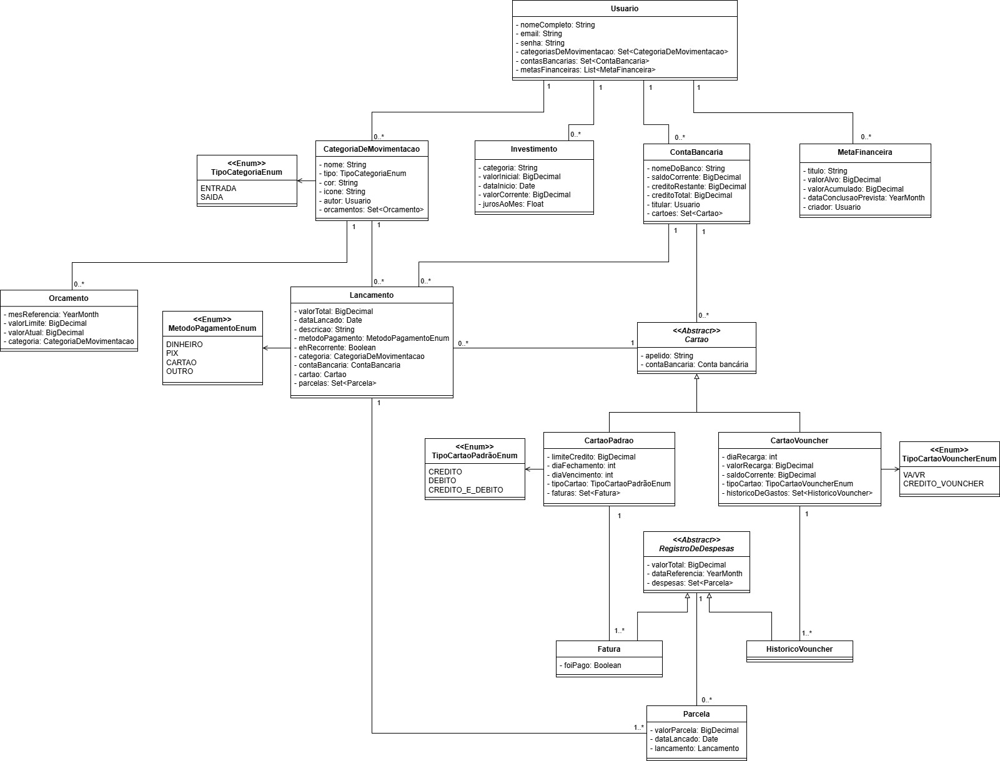
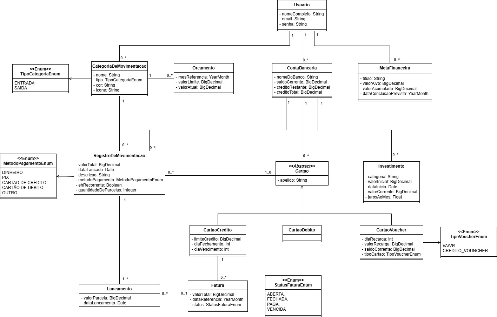

# Gestão financeira

API REST em Java 25, Spring Boot 4.1.1 e PostgreSQL. A organização existente foi mantida: controllers e seus contratos OpenAPI, DTOs, services, repositories e entities.

## Pré-requisitos

- Java 25 e Maven 3.9+ para executar ou testar localmente.
- Docker com Compose para executar banco e API em containers e provisionar o PostgreSQL dos testes.
- PostgreSQL 16 para execução fora do Docker.

## Executar com Docker

1. Copie `.env.example` para `.env`.
2. Defina `POSTGRES_USER`, `POSTGRES_DB`, `POSTGRES_PASSWORD` e um `JWT_SECRET` aleatório com pelo menos 32 bytes. Não versionar esses valores.
3. Para criar o primeiro usuário real, configure `INITIAL_USER_ENABLED=true`, nome, email e senha nas variáveis `INITIAL_USER_*`. A senha deve ter pelo menos 12 caracteres e no máximo 72 bytes UTF-8.
4. Execute:

```powershell
docker compose up -d --build
docker compose logs -f aplicacao
```

A API fica em `http://localhost:8080/api`. O Compose usa o perfil `prod`, aguarda o healthcheck do PostgreSQL e conecta a API ao banco pela rede interna. O banco é publicado apenas em `127.0.0.1`. A imagem executa a aplicação sem privilégios de root.

O usuário inicial é criado apenas se o email ainda não existir; reiniciar não redefine sua senha. Após provisionar, desative `INITIAL_USER_ENABLED` e remova sua senha do ambiente. Sem provisionamento, o banco inicia vazio e não há credenciais de acesso predefinidas em produção.

`docker compose down` preserva o volume do banco. A opção `-v` remove os dados e não deve ser usada em um ambiente que precise ser preservado.

Como as migrations foram consolidadas durante o desenvolvimento, recrie o banco local antes de iniciar esta versão:

```powershell
docker compose down -v
docker compose up -d bancoDeDados
```

Depois, para usar os mocks pelo perfil `dev`, inicie a aplicação local com `DATA_MOCK_ENABLED=true`. O Flyway criará somente a V1 completa e o `DataMock` criará o cenário financeiro atualizado.

## Executar localmente

O Maven não carrega `.env` automaticamente. No PowerShell, carregue o arquivo simples fornecido pelo projeto e inicie o banco:

```powershell
Get-Content .env | ForEach-Object {
    if ($_ -match '^([A-Z0-9_]+)=(.*)$') {
        [Environment]::SetEnvironmentVariable($Matches[1], $Matches[2], 'Process')
    }
}
docker compose up -d bancoDeDados
$env:SPRING_PROFILES_ACTIVE = 'dev'
mvn spring-boot:run
```

Para gerar o executável: `mvn verify`. Para executá-lo: `java -jar target/gestao-financeira-0.0.1-SNAPSHOT.jar`, com as variáveis configuradas.

Nenhum perfil de desenvolvimento é ativado implicitamente. Sem perfil, as configurações comuns também exigem credenciais externas e desativam Swagger e dados de demonstração. Os perfis `dev` e `prod` não podem ser usados juntos.

No perfil `dev`:

- Swagger: `http://localhost:8080/api/swagger-ui/index.html`.
- OpenAPI: `http://localhost:8080/api/v3/api-docs`.
- `DATA_MOCK_ENABLED=true` habilita o cenário local completo com o usuário `admin@gmail.com` e a senha definida em `INITIAL_USER_PASSWORD`. O padrão é `false`; se a variável não estiver definida, o mock usa `admin123`.
- Na primeira inicialização são criados dados idempotentes de demonstração: duas contas, categorias, orçamentos, cartões de crédito/débito/voucher, movimentações de entrada e saída, recorrência mensal, compras parceladas, faturas, investimentos e metas. As datas relativas são calculadas a partir do dia da inicialização para manter o dashboard útil em qualquer mês.
- O fixture não é executado no perfil `prod` e não cria dados automaticamente no Docker, que usa `SPRING_PROFILES_ACTIVE=prod`. Para testar pelo frontend, execute a API com o perfil `dev`, PostgreSQL disponível e `DATA_MOCK_ENABLED=true`, autentique com as credenciais acima e use o token retornado no cabeçalho `Authorization`.
- A carga é idempotente: se a conta `Banco Aurora (Mock)` já existir para o usuário de demonstração, a inicialização não duplica os registros. Para recriar o cenário, remova os dados desse usuário no banco de desenvolvimento ou use um banco limpo.

A dependência springdoc foi ajustada para a série 3, compatível com Spring Boot 4, conforme a [documentação oficial](https://springdoc.org/). Os contratos continuam definidos nas interfaces existentes e nos DTOs.

## Variáveis de ambiente

| Variável | Finalidade e exemplo não sensível | Padrão / obrigatoriedade |
| --- | --- | --- |
| `SPRING_PROFILES_ACTIVE` | Perfil: `dev` ou `prod` | Sem perfil por padrão; Compose usa `prod` |
| `SERVER_PORT` | Porta HTTP publicada, exemplo `8080` | `8080`; no Compose a porta interna permanece 8080 |
| `JWT_SECRET` | Segredo aleatório de pelo menos 32 bytes | Obrigatório fora de dev/test; padrão local exclusivo em dev |
| `CORS_ALLOWED_ORIGIN` | Origens completas separadas por vírgula, exemplo `https://financas.example.com` | Vazio bloqueia origens externas; dev permite localhost:4200 e localhost:3000 |
| `POSTGRES_HOST` | Endereço do PostgreSQL para execução local e testes | `localhost`; Compose define `bancoDeDados` para a API |
| `POSTGRES_USER` | Usuário criado pelo container e usado pela aplicação e pelos testes | Obrigatório, sem padrão |
| `POSTGRES_PASSWORD` | Senha do usuário PostgreSQL, usada pela aplicação e pelos testes | Obrigatória, sem padrão |
| `POSTGRES_DB` | Banco da aplicação, exemplo `gestao_financeira`; os testes acrescentam `_test` ao nome | Obrigatório, sem padrão |
| `POSTGRES_PORT` | Porta local do PostgreSQL, usada pela aplicação e pelos testes | `5432`; Compose usa a porta interna 5432 para a API |
| `DATA_MOCK_ENABLED` | Habilita o usuário e o cenário financeiro local de desenvolvimento | `false`; ignorado fora de dev |
| `INITIAL_USER_ENABLED` | Provisiona o primeiro usuário real | `false` |
| `INITIAL_USER_NAME` | Nome do usuário inicial | Obrigatório quando o provisionamento está ativo |
| `INITIAL_USER_EMAIL` | Email do usuário inicial | Obrigatório quando o provisionamento está ativo |
| `INITIAL_USER_PASSWORD` | Senha do usuário inicial | Obrigatória quando ativo, sem padrão |

Credenciais de banco, JWT e usuário inicial nunca têm valores predefinidos em produção. Não use `*` nas origens CORS com credenciais. O perfil `test` pertence aos recursos de teste e não deve ser utilizado como ambiente de execução.

## Banco e migrations

O Flyway executa `src/main/resources/db/migration/V1__criar_schema.sql` antes da validação do Hibernate. A V1 já contém o schema completo: agendamento, recorrências, rendimentos, numeração de parcelas, saldo inicial, pagamentos e snapshots mensais. O JPA usa `ddl-auto: validate`; reinícios não recriam tabelas.

As colunas monetárias têm duas casas decimais, as referências de faturas usam `YYYY-MM` e a unicidade das categorias é por usuário. Código e HTTP usam UTF-8; o Compose cria novos bancos com UTF-8.

Como o projeto ainda está em desenvolvimento, a consolidação atual exige recriar o banco de desenvolvimento e o banco de testes. Não aplique esta V1 sobre um banco que tenha o histórico antigo V1-V5; remova os volumes/bancos locais e deixe o Flyway criar o schema completo novamente.

## Autenticação

`POST /api/auth/acessar`:

```json
{"email":"seu-email@example.com","senha":"sua-senha"}
```

A resposta contém `token.username`, `token.created`, `token.expiration` e `token.accessToken`. Envie o token nas demais requisições:

```http
Authorization: Bearer <token.accessToken>
```

Para cadastrar um usuário, use `POST /api/auth/cadastrar` sem autenticação:

```json
{"nome":"João Silva","email":"joao@example.com","senha":"uma-senha-com-12-caracteres"}
```

O cadastro retorna `201` com os dados públicos do usuário, não retorna a senha e não autentica automaticamente. A senha deve ter entre 12 e 72 caracteres e emails são normalizados para minúsculas; email duplicado retorna `409`.

O JWT expira em 12 horas. `GET /api/auth/me` retorna o usuário autenticado. Token inválido, ausente ou credenciais incorretas retornam 401. Recursos de outro usuário retornam 404 e não podem ser usados como referências em cadastros.

## Endpoints principais

Todos os caminhos abaixo usam o prefixo `/api`. Cadastros retornam 200 com o DTO do recurso; listas retornam arrays.

| Método e caminho | Uso |
| --- | --- |
| `POST /contas-bancarias`, `GET /contas-bancarias` | Cadastrar e listar contas próprias |
| `PUT /contas-bancarias/{id}`, `DELETE /contas-bancarias/{id}` | Renomear e excluir conta sem cartões ou movimentações |
| `POST /categorias-movimentacao`, `GET /categorias-movimentacao` | Cadastrar e listar categorias próprias |
| `GET /categorias-movimentacao/{id}` | Consultar uma categoria |
| `PUT /categorias-movimentacao/{id}`, `DELETE /categorias-movimentacao/{id}` | Editar e excluir categoria sem uso |
| `POST /categorias-movimentacao/{id}/orcamentos`, `GET /categorias-movimentacao/{id}/orcamentos` | Orçamentos da categoria |
| `PUT/DELETE /categorias-movimentacao/{categoriaId}/orcamentos/{orcamentoId}` | Editar ou excluir orçamento |
| `POST /cartoes`, `GET /cartoes/{contaId}` | Cadastrar e listar cartões da conta |
| `GET /contas-bancarias/{contaId}/cartoes/{cartaoId}` | Consultar cartão por ID dentro da conta |
| `PUT /cartoes/{id}`, `DELETE /cartoes/{id}` | Editar ou excluir cartão sem faturas ou movimentações |
| `POST /contas-bancarias/{contaId}/registros-de-movimentacao` | Registrar movimentação e seus lançamentos |
| `GET /contas-bancarias/{contaId}/registros-de-movimentacao` | Consultar movimentações por período |
| `GET /contas-bancarias/registros-de-movimentacao/{id}` | Consultar uma movimentação |
| `DELETE /contas-bancarias/registros-de-movimentacao/{id}` | Cancelar movimentação completa; retorna 204 |
| `PATCH /contas-bancarias/registros-de-movimentacao/{id}` | Editar somente a descrição |
| `PATCH /contas-bancarias/registros-de-movimentacao/{id}/recorrencia` | Ativar ou cancelar gerações futuras da recorrência |
| `GET /contas-bancarias/{contaId}/lancamentos` | Consultar lançamentos por período |
| `GET /contas-bancarias/{contaId}/cartoes/{cartaoId}/faturas` | Consultar faturas por período |
| `GET /contas-bancarias/{contaId}/cartoes/{cartaoId}/faturas/{faturaId}` | Consultar fatura e lançamentos |
| `POST /cartoes/faturas/{id}/pagamento` | Pagar integralmente a fatura com saldo da conta do cartão |
| `DELETE /auth/me` | Excluir a conta do usuário quando não houver recursos vinculados |
| `GET /dashboard?mesReferencia=2026-10` | Consultar o resumo financeiro consolidado do usuário autenticado por mês |
| `POST /investimentos`, `GET /investimentos` | Cadastrar e listar investimentos próprios |
| `PUT /investimentos/{id}`, `DELETE /investimentos/{id}` | Editar ou excluir investimento |
| `POST /metas-financeiras`, `GET /metas-financeiras` | Cadastrar e listar metas próprias |
| `PUT /metas-financeiras/{id}`, `DELETE /metas-financeiras/{id}` | Editar ou excluir meta |

Consultas por período exigem `?dataInicial=2024-01-01&dataFinal=2024-12-31`. Os limites são inclusivos e a data final não pode preceder a inicial. O dashboard aceita `?mesReferencia=2026-10`; faturas, movimentações, lançamentos e orçamentos são filtrados por esse mês. Se omitido, o mês atual é usado. Após o fechamento automático, `snapshotHistoricoDisponivel` informa se saldo e crédito históricos estão disponíveis em `contasNoMes`; investimentos históricos são retornados em `investimentosNoMes` quando `snapshotInvestimentosHistoricoDisponivel` for verdadeiro. As contas e investimentos principais continuam sendo o estado atual.

Conta:

```json
{"nomeDoBanco":"Minha conta","saldoCorrente":1000.00,"creditoTotal":1000.00,"creditoRestante":1000.00}
```

Saldo omitido inicia em zero; crédito restante omitido assume o total. Não podem ser negativos, nem o restante pode superar o total. A resposta inclui `id`, saldos e `creditoUsado`.

Categoria:

```json
{"nome":"Alimentação","tipo":"SAIDA","cor":"#F59E0B","icone":"utensils"}
```

`tipo` aceita `ENTRADA` ou `SAIDA`. A resposta inclui `id` e o orçamento mais recente, quando existir.

Cartão de crédito:

```json
{"tipoCartao":"CREDITO","contaBancariaId":"<contaId>","apelido":"Principal","cartaoCredito":{"limiteCredito":1000.00,"diaFechamento":10,"diaVencimento":17}}
```

Para débito, use `tipoCartao: "DEBITO"` e omita os objetos específicos. Para voucher, use:

```json
{"tipoCartao":"VOUCHER","contaBancariaId":"<contaId>","apelido":"Benefício","cartaoVoucher":{"tipoVoucher":"VA_VR","valorRecarga":500.00,"diaRecarga":1,"saldoCorrente":500.00}}
```

Os tipos de voucher existentes são `VA_VR` e `CREDITO_VOUNCHER` (grafia preservada por compatibilidade). Dias aceitam 1 a 31; datas em meses curtos são ajustadas ao último dia. O saldo de voucher omitido inicia em zero. A recarga configurada é aplicada automaticamente uma vez por mês a partir do dia informado; ela não é um pagamento bancário nem gera uma movimentação de conta.

Movimentação parcelada:

```json
{"valorTotal":100.00,"metodoPagamento":"CARTAO_CREDITO","categoriaId":"<categoriaSaidaId>","dataLancamento":"2024-01-05","descricao":"Compra","ehRecorrente":false,"quantidadeParcelas":3,"cartaoId":"<cartaoCreditoId>"}
```

A resposta inclui `id`, `valorTotal`, `dataLancamento`, `metodoPagamento`, `qntParcelas`, `categoriaId` e `contaBancariaId`. Lançamentos são gerados pelo serviço da movimentação e consultados como `id`, `valor`, `dataLancamento`, `descricao`, `metodoPagamento`, `ehRecorrente`, `proximaRecorrencia`, `numeroParcela`, `totalParcelas`, `faturaId`, dados da categoria, conta e cartão; não há cadastro independente por HTTP.

Regras financeiras:

- Valores de movimentação devem ser positivos, com até duas casas decimais. A data é obrigatória e não pode ser futura.
- `PIX`, `DINHEIRO`, `OUTRO` e `CARTAO_DEBITO`: entrada soma e saída subtrai o saldo da conta. Saída sem saldo é rejeitada.
- `VOUCHER`: usa somente o saldo do voucher. Entrada registra recarga; saída consome esse saldo.
- `CARTAO_CREDITO`: exige categoria de saída e 1 a 120 parcelas, cada uma com pelo menos um centavo. Consome o valor integral do limite disponível do cartão e do crédito restante da conta; não debita saldo corrente na compra.
- Outros métodos admitem apenas uma parcela. Cartão é obrigatório para métodos de cartão e deve ter tipo e conta compatíveis.
- Compra anterior ao fechamento entra no ciclo corrente; no dia do fechamento ou depois, entra no próximo. Se o dia de vencimento for anterior ou igual ao fechamento, o vencimento ocorre no mês seguinte ao fechamento.
- R$ 100,00 em três parcelas produz R$ 33,34, R$ 33,33 e R$ 33,33. Cada parcela pertence a uma fatura mensal e sua data é o vencimento daquela fatura.
- Faturas somam seus lançamentos. São `ABERTA` antes do fechamento, `FECHADA` do fechamento ao vencimento, `VENCIDA` após o vencimento com valor pendente e `PAGA` após pagamento. Consultas atualizam a situação pelo calendário.
- Pagamento é integral, exige saldo, debita a conta e libera o limite correspondente. Repetir o pagamento não duplica o débito. Não há pagamento parcial, juros ou multas automáticas.
- Cancelamento exclui todas as parcelas e recalcula as faturas na mesma transação. Não é permitido quando alguma fatura já foi paga ou quando o estorno de uma entrada deixaria saldo negativo.
- O agendamento financeiro executa diariamente: garante a fatura do mês atual para cada cartão de crédito, atualiza faturas não pagas pelo calendário, processa uma recarga mensal de cada voucher e fecha o mês anterior criando snapshots idempotentes de contas e investimentos. As operações são idempotentes e o pagamento de fatura continua manual pelo endpoint, agora com evento persistido para auditoria e reconstrução histórica.
- Depois que um mês é fechado, movimentações daquele período não podem ser excluídas fisicamente; correções devem ser registradas como ajustes ou estornos para preservar o snapshot e a auditoria.
- `ehRecorrente` gera indefinidamente uma nova movimentação mensal com os mesmos dados do registro original. A próxima data prevista é retornada na resposta e o scheduler evita duplicidades.
- Investimentos aplicam juros compostos mensais após o primeiro mês, no dia correspondente à `dataInicio`; meses curtos usam o último dia disponível.

Dados inválidos ou regras de negócio retornam 400; duplicidades retornam 409. Os erros de validação informam os campos; os demais seguem `localDateTime`, `message` e `details`. As alterações financeiras usam transações e bloqueio da conta para impedir perda de saldo em requisições simultâneas.

## Testes

Os testes usam exclusivamente PostgreSQL, com o perfil `test` e migrations reais. A configuração vem das mesmas variáveis `POSTGRES_*` da aplicação: servidor, porta, usuário e senha são compartilhados; o nome do banco recebe o sufixo `_test`. Por exemplo, `POSTGRES_DB=gestao_financeira` utiliza `gestao_financeira_test` nos testes.

O banco de testes é persistente e fica no mesmo volume PostgreSQL da aplicação. Carregue o `.env` e inicie o PostgreSQL:

```powershell
Get-Content .env | ForEach-Object {
    if ($_ -match '^([A-Z0-9_]+)=(.*)$') {
        [Environment]::SetEnvironmentVariable($Matches[1], $Matches[2], 'Process')
    }
}
docker compose up -d --wait bancoDeDados
```

Crie o banco de testes uma única vez. Se ele já existir, pule este comando:

```powershell
docker compose exec -T bancoDeDados createdb -U $env:POSTGRES_USER "$($env:POSTGRES_DB)_test"
```

Depois, execute `mvn verify`. As tabelas são criadas pelas migrations. Para PostgreSQL instalado diretamente na máquina, crie o mesmo banco com `createdb -h $env:POSTGRES_HOST -p $env:POSTGRES_PORT -U $env:POSTGRES_USER "$($env:POSTGRES_DB)_test"` e execute os testes com o `.env` carregado.

A suíte HTTP inicia a aplicação real, autentica com JWT e verifica saldos, parcelas, rollback, pagamento, cancelamento, isolamento, CORS e concorrência. Dados criados nos testes permanecem no banco com sufixo `_test`; o banco da aplicação é separado. Resultados ficam em `target/surefire-reports`. Os casos de calendário cobrem fechamento, vencimento, meses curtos, anos bissextos e virada de ano.

## Modelos originais

### V2.0.0



### V2.0.1


