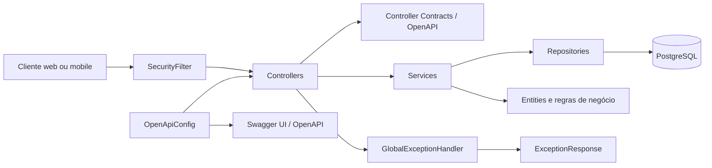
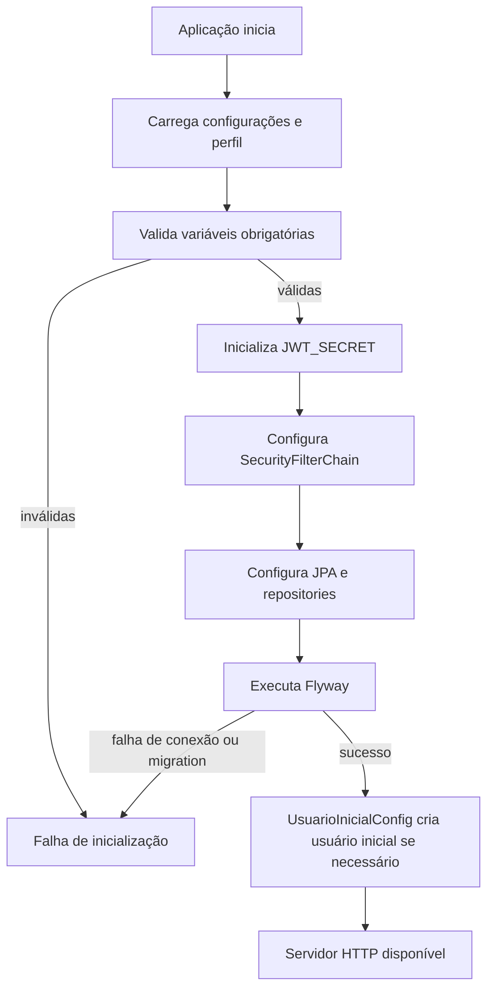
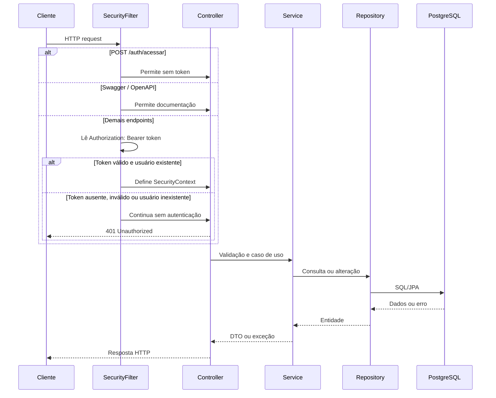
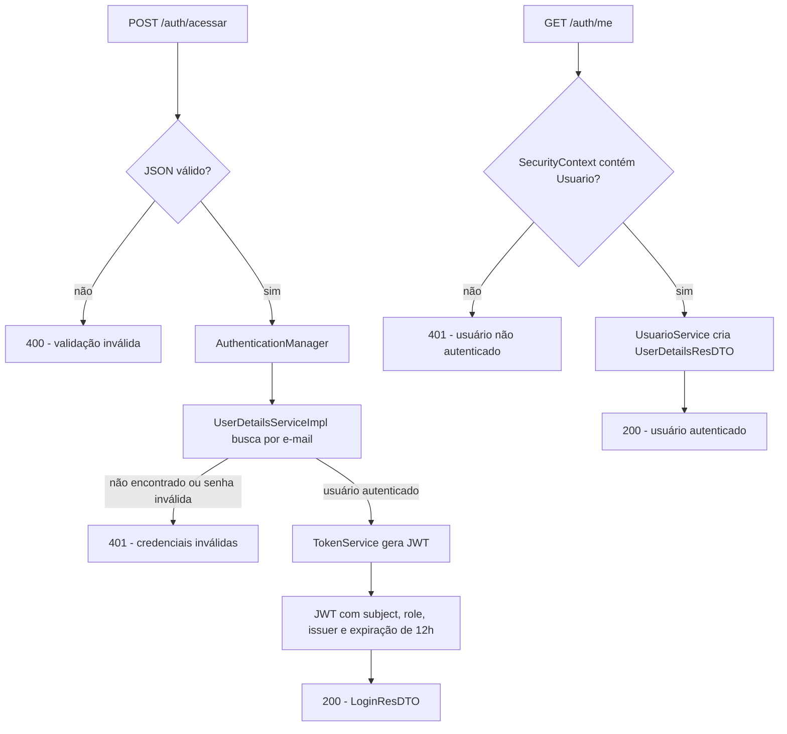
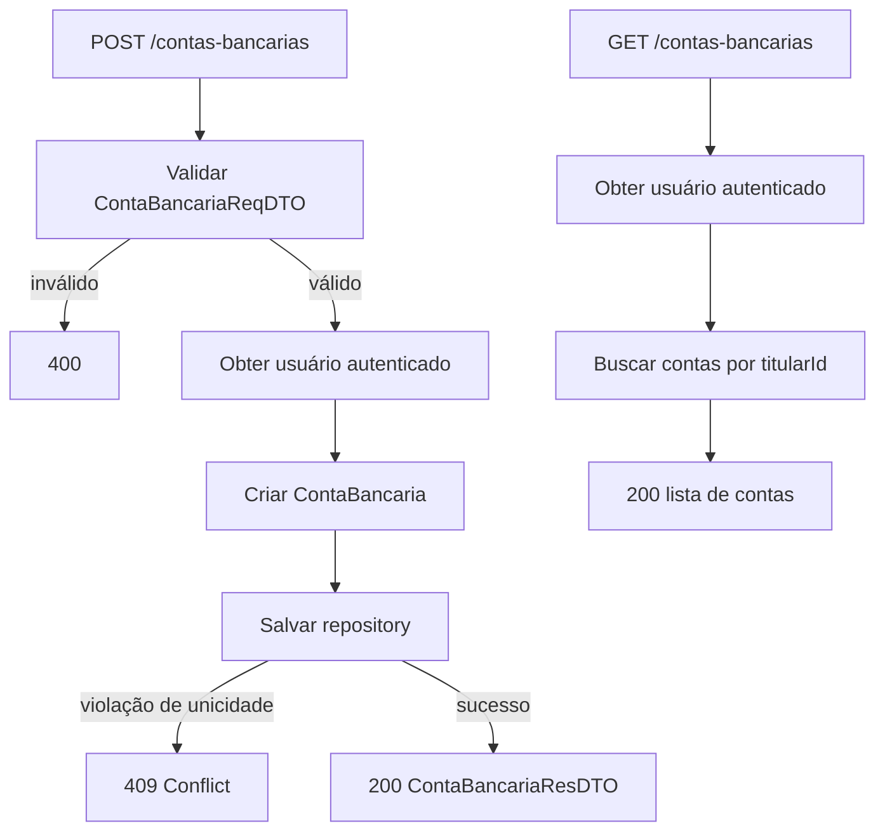
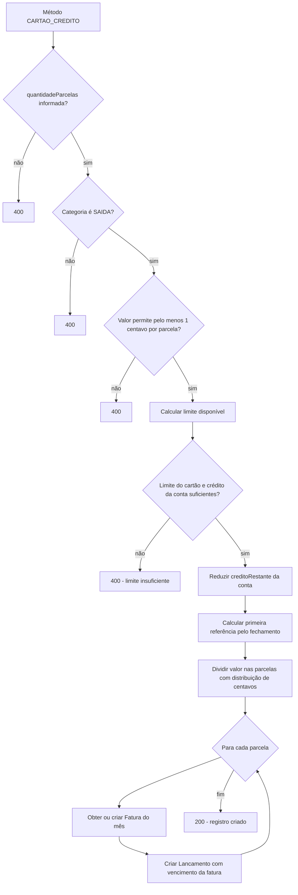
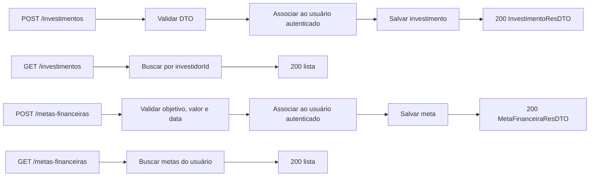
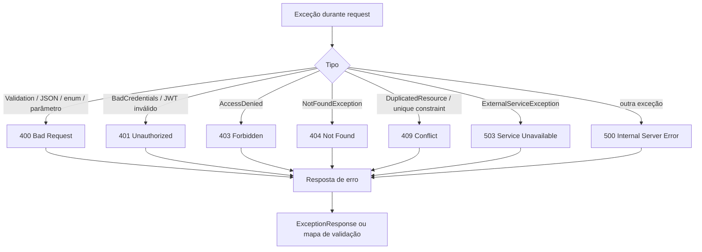
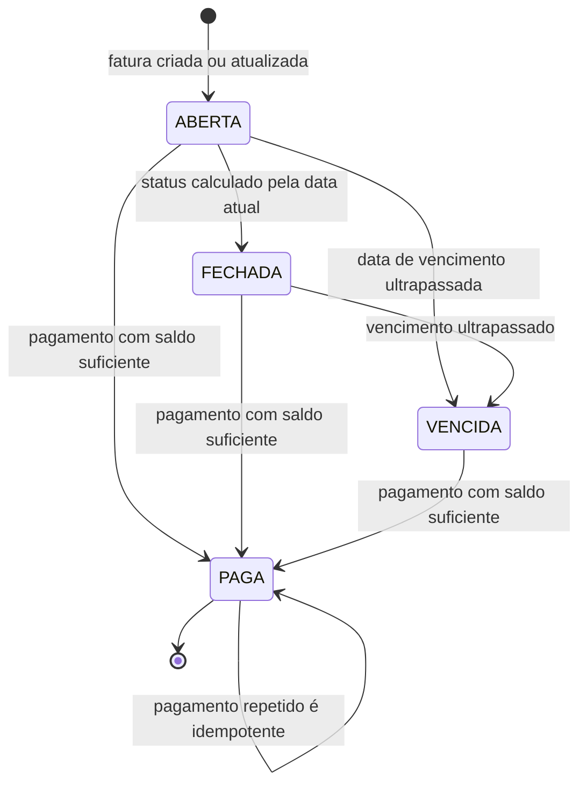

# Diagramas de fluxos do sistema

Este documento representa os fluxos implementados atualmente pela API. O prefixo
`/api` vem de `server.servlet.context-path`; os caminhos dos controllers abaixo
estão apresentados sem esse prefixo.

## 1. Visão geral da arquitetura



## 2. Inicialização da aplicação



## 3. Fluxo comum de uma requisição



## 4. Autenticação e usuário atual



## 5. Cadastro e consulta de contas bancárias



## 6. Categorias e orçamentos

```mermaid
flowchart TD
    A[POST /categorias-movimentacao] --> B[Validar nome, tipo, cor e ícone]
    B -->|inválido| E400[400]
    B -->|válido| C[Criar categoria para usuário atual]
    C --> D[Salvar]
    D --> E[200 CategoriaMovimentacaoResDTO]

    F[GET /categorias-movimentacao] --> G[Buscar por autorId]
    G --> H[200 lista]

    I[GET /categorias-movimentacao/{categoriaId}] --> J[Buscar por id + autorId]
    J -->|não encontrada| E404[404]
    J -->|encontrada| K[200 categoria]

    L[POST /categorias-movimentacao/{categoriaId}/orcamentos] --> M[Validar categoria do usuário]
    M -->|não encontrada| E404B[404]
    M -->|válida| N[Criar orçamento para a categoria]
    N --> O[Salvar e retornar 200]

    P[GET /categorias-movimentacao/{categoriaId}/orcamentos] --> Q[Consultar orçamentos da categoria]
    Q --> R[200 lista de orçamentos]
```

## 7. Cadastro de cartões

```mermaid
flowchart TD
    A[POST /cartoes] --> B[Validar CartaoReqDTO]
    B -->|inválido| X[400]
    B -->|válido| C[Buscar conta do usuário]
    C -->|não encontrada| E404[404]
    C -->|encontrada| D{tipoCartao}
    D -->|CREDITO| E{cartaoCredito preenchido e voucher ausente?}
    D -->|DEBITO| F{dados de crédito e voucher ausentes?}
    D -->|VOUCHER| G{cartaoVoucher preenchido e crédito ausente?}
    E -->|não| X2[400 - payload incompatível]
    F -->|não| X2
    G -->|não| X2
    E -->|sim| H[Criar CartaoCredito]
    F -->|sim| I[Criar CartaoDebito]
    G -->|sim| J[Criar CartaoVoucher]
    H --> K[Salvar e retornar DTO]
    I --> K
    J --> K

    L[GET /cartoes/{contaBancariaId}] --> M[Validar conta do usuário]
    M --> N[Buscar cartões da conta]
    N --> O[Mapear por subtipo e retornar 200]
```

## 8. Cadastro de movimentação: todos os métodos de pagamento

```mermaid
flowchart TD
    A[POST /contas-bancarias/{contaBancariaId}/registros-de-movimentacao] --> B[Validar DTO e período]
    B -->|inválido| X[400]
    B -->|válido| C[Bloquear conta para atualização]
    C --> D[Buscar categoria do usuário]
    D --> E{Método usa cartão?}
    E -->|DINHEIRO, PIX ou OUTRO| F{cartaoId está vazio?}
    F -->|não| X2[400 - método não usa cartão]
    F -->|sim| G{quantidadeParcelas = 1?}
    E -->|CARTAO_CREDITO, CARTAO_DEBITO ou VOUCHER| H{cartaoId informado?}
    H -->|não| X3[400 - cartão obrigatório]
    H -->|sim| I[Buscar cartão do usuário]
    I --> J{Cartão pertence à conta e é compatível?}
    J -->|não| X4[400 - cartão incompatível]
    J -->|sim| G
    G -->|não| X5[400 - apenas crédito parcela]
    G -->|sim| K{Categoria ENTRADA ou SAIDA}
    K -->|ENTRADA| L[Somar ao saldo aplicável]
    K -->|SAIDA| M[Subtrair do saldo aplicável]
    L --> N{Saldo resultante >= 0?}
    M --> N
    N -->|não| X6[400 - saldo insuficiente]
    N -->|sim| O[Criar RegistroDeMovimentacao]
    O --> P[Criar lançamento único]
    P --> Q[200 - RegistroMovimentacaoResDTO]
```

## 9. Compra no crédito e criação de faturas



## 10. Consultas de movimentações e lançamentos

```mermaid
flowchart TD
    A[GET /contas-bancarias/{id}/registros-de-movimentacao] --> B[Validar dataInicial e dataFinal]
    B -->|data final anterior à inicial| X[400]
    B -->|válido| C[Validar conta do usuário]
    C -->|não encontrada| E404[404]
    C -->|encontrada| D[Buscar registros entre datas]
    D --> E[200 lista de registros]

    F[GET /contas-bancarias/registros-de-movimentacao/{registroId}] --> G[Buscar por id + titular]
    G -->|não encontrado| E404B[404]
    G -->|encontrado| H[200 registro]

    I[GET /contas-bancarias/{id}/lancamentos] --> J[Validar período e conta]
    J --> K[Buscar lançamentos relacionados ao período]
    K --> L[200 lista de lançamentos]
```

## 11. Faturas: consulta, status e pagamento

```mermaid
flowchart TD
    A[GET /cartoes/{cartaoId}/faturas] --> B[Buscar cartão do usuário]
    B -->|não é crédito| X[400 - faturas exigem crédito]
    B -->|crédito| C[Validar conta e período]
    C --> D[Buscar faturas entre YearMonth inicial/final]
    D --> E[Atualizar status de cada fatura]
    E --> F[200 lista ordenada por referência]

    G[GET /cartoes/faturas/{faturaId}] --> H[Bloquear conta da fatura]
    H --> I[Buscar fatura pertencente ao usuário]
    I -->|não encontrada| E404[404]
    I -->|encontrada| J[Atualizar status]
    J --> K[200 FaturaResDTO com lançamentos]

    L[POST /cartoes/faturas/{faturaId}/pagamento] --> M[Bloquear conta]
    M --> N[Buscar fatura]
    N -->|já PAGA| O[Retornar sem alterar saldos]
    N -->|ABERTA, FECHADA ou VENCIDA| P{Saldo da conta suficiente?}
    P -->|não| X2[400 - saldo insuficiente]
    P -->|sim| Q[Marcar fatura como PAGA]
    Q --> R[Debitar saldo corrente]
    R --> S[Devolver crédito restante]
    S --> T[200 FaturaResDTO]
    O --> T
```

## 12. Exclusão de movimentação e estorno

```mermaid
flowchart TD
    A[DELETE /contas-bancarias/registros-de-movimentacao/{registroId}] --> B[Buscar registro do usuário]
    B -->|não encontrado| X404[404]
    B -->|encontrado| C[Bloquear conta]
    C --> D[Verificar todas as parcelas]
    D --> E{Alguma parcela está em fatura PAGA?}
    E -->|sim| X400[400 - não pode alterar fatura paga]
    E -->|não| F[Remover parcelas das faturas e recalcular totais]
    F --> G{Método era CARTAO_CREDITO?}
    G -->|sim| H[Devolver valor ao creditoRestante]
    G -->|não| I[Reverter variação no saldo da conta ou voucher]
    H --> J[Excluir registro]
    I --> K{Saldo resultante válido?}
    K -->|não| X400B[400 - saldo insuficiente para estorno]
    K -->|sim| J
    J --> L[204 No Content]
```

## 13. Investimentos e metas financeiras



## 14. Tratamento de erros



## 15. Catálogo de rotas cobertas

| Controller | Rotas |
|---|---|
| AuthController | `POST /auth/acessar`, `GET /auth/me` |
| ContaBancariaController | `POST /contas-bancarias`, `GET /contas-bancarias`, consultas e exclusão de movimentações, lançamentos |
| CategoriaMovimentacaoController | cadastro/consulta de categorias e orçamentos |
| CartaoController | cadastro/consulta de cartões, consulta e pagamento de faturas |
| InvestimentoController | cadastro e consulta de investimentos |
| MetaFinanceiraController | cadastro e consulta de metas financeiras |

Todos os fluxos acima dependem do usuário autenticado, exceto o login e os
recursos públicos de Swagger/OpenAPI.

## 16. Máquina de estados das faturas


